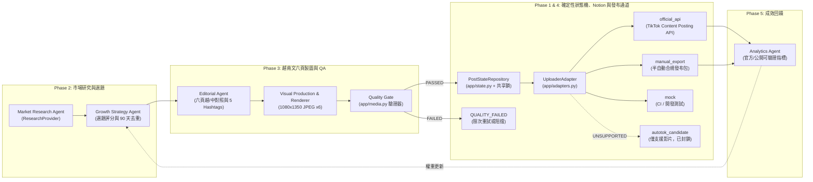

# 系統架構設計文件（ARCHITECTURE.md）

> 依據 [`MASTER_SPEC.md`](MASTER_SPEC.md) 建立。本系統採用「多 Agent 內容生產與驗證」結合「確定性排程與發布狀態機」之混合架構，目前已完成 Phase 1 核心發布驗證與工程骨架，並預留完整介面支援 Phase 2–5。

---

## 1. 系統全貌與資料流

---

## 2. 核心模組職責與程式碼對應

| 模組路徑 | 職責說明 | 對應階段 |
|---|---|---|
| [`app/config.py`](app/config.py) | Pydantic Settings 環境設定管理、`ALLOW_LIVE_PUBLISH` 安全閘門、敏感憑證遮罩（`redact_sensitive`）。 | Phase 1–5 |
| [`app/errors.py`](app/errors.py) | 明確區分 `UnsupportedFeatureError`、`BlockedNeedsAuthError`、`BlockedNeedsAuditError`、`MediaValidationError`，禁止將未授權或失敗偽裝為成功。 | Phase 1–5 |
| [`app/models.py`](app/models.py) | 定義 `PostStatus` 狀態機、`ContentSlot`（07:00 / 11:30 / 18:00）、`SlideItem`（1–6 頁越中對照）、`CarouselPostPackage`（強制驗證 6 頁與 5 個 Hashtag）及 `PublishExecutionPlan`。 | Phase 1–5 |
| [`app/media.py`](app/media.py) | 六張獨立 1080×1350 (4:5) JPEG 測試圖產生器與 `verify_carousel_directory` 品質 Gate（檢查數量、頁碼順序 01–06、真實 JPEG Magic Bytes `FF D8 FF`、尺寸、SHA-256 防重複）。 | Phase 1 & 3 |
| [`app/adapters.py`](app/adapters.py) | `UploaderAdapter` 抽象介面與 `mock`、`official_api`、`autotok_candidate`、`manual_export` 四種可替換實作。 | Phase 1 & 4 |
| [`app/state.py`](app/state.py) | `PostStateRepository` 貼文狀態機與發布鎖（`acquire_publish_lock`）實作。Phase 1 以 SQLite 為單機原型，Phase 4 可無縫切換至雲端共享交易資料庫。 | Phase 1 & 4 |
| [`app/cli.py`](app/cli.py) | 提供 `python -m app generate-mock-media`、`verify-media`、`publish --dry-run` 命令列工具。 | Phase 1–5 |

---

## 3. 貼文狀態機（State Machine）與防重發機制

遵循 [`MASTER_SPEC.md`](MASTER_SPEC.md) 第 8 節，貼文生命週期如下：

`DRAFT → RESEARCHED → GENERATING → READY_TO_REVIEW / QUALITY_FAILED → READY → SCHEDULED → PUBLISHING → PUBLISHED / FAILED / UNKNOWN`

### 關鍵防護規則：
1. **品質未過關禁止排程**：若 `verify_carousel_directory` 回報任何尺寸、非 JPEG（如 PNG）、少於 6 張或重複圖片錯誤，狀態轉為 `QUALITY_FAILED`，不得進入 `READY` 或 `PUBLISHING`。
2. **`UNKNOWN` 狀態保護**：當網路超時或平台回傳非預期結果時，狀態標記為 `UNKNOWN`；此時 `acquire_publish_lock()` 會拒絕再次取得鎖，要求先透過狀態查詢確認是否已上線，嚴禁盲目重傳造成重複發文。
3. **跨環境防重發（GitHub Actions vs. Windows Task Scheduler）**：
   - **重要限制揭露**：GitHub Actions runner 為臨時性（ephemeral）虛擬機，執行結束後本地 SQLite 檔案即銷毀，因此**單靠 Actions runner 內的本地 SQLite 無法防止 GitHub Actions 與 Windows 常開機同時重複發布**。
   - **Phase 4 生產解法**：`PostStateRepository` 已將狀態與鎖定封裝為獨立介面（`acquire_publish_lock(post_id, runner_id)`），在 Phase 4 正式啟用雲端＋本機雙排程前，將連接共享持久化儲存（Notion Database 狀態原子更新或雲端 PostgreSQL / Turso）以確保跨機器分散式鎖定。
